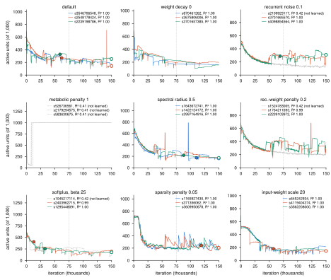

## 2026-11-02 18:22 — DMTS setting sweeps: the pass/fail rule fails (one counterexample, recurrent noise 0.1); three of eight settings untested

Work package dmts-readout (dead-relu-paper #127). Reads the 27 networks that the plan entry
`2026-11-01_2124_dmts-sweeps-plan.md` set up, under the read-out and the pass/fail rule fixed there
before any network trained. The rule is applied as written.

**Result.** The extension of "no standard setting stops the decrease" to DMTS (delayed match-to-sample)
**fails**. Nine networks learned the task and have a floor crossing. Eight of the nine have fewer active
units at the end of training than at the crossing. One, trained with recurrent noise σ_rec = 0.1
(seed 4098854564), has 288 active units at its crossing and 308 at the end. Three of the eight
settings are **untested**: weight decay 0, metabolic penalty 1 and recurrent-weight penalty 0.2 have
no network that both learned the task and reached a floor crossing.

### What was run

- Training: Della job 16628171, array 1-27, all COMPLETED (6.4-7.0 h each), from the pinned checkout
  `~/trainRNNbrain_dmtsset` at ba4c29b. Outputs, listed on Della on 2 Nov:
  `/scratch/gpfs/TENGEL/pt1290/trainRNNbrain/data/trained_RNNs/DMTS_std_settings/EqType=h_N=1000_arm=<arm>_iters=150000/`
  (9 cells, 3 networks each) and `.../data/c1_snapshots/DMTS_std_settings/<cell>/s<seed>/`. Every one
  of the 27 networks has its `TrainLosses.json`, `ParticipationTrace.pkl`, final `LastParams`, 149
  kept snapshots (`it0001000` to `it0149000`, one every 1,000 iterations) and `resume/`.
- Read-out: `trainRNNbrain/experiments_and_analysis/dmts_settings_readout.py` (branch
  `wp/dmts-readout`, commit 7120452 for the collected numbers). It ran on Della as CPU job 16697623
  (array 0-8, one arm per task, 7-13 min each, 8 CPUs) from a new checkout `~/trainRNNbrain_dmtsread`,
  detached at 7120452 and moved there as a git bundle. The code it uses is unchanged between
  ba4c29b and main: `git diff --stat ba4c29b main` is empty for `common.py`, `heldout_r2.py`, the task,
  model, training and trainer code. Its per-arm pickles are in `data/dmts_settings/<arm>.pkl` on Della
  and on the Mac. `python dmts_settings_readout.py report` prints every table below and draws the figure.
- The code path is that of the CDDM and 3BFF sweeps: `common.load_run` and `common.read_run` (1.05× each
  network's own noisy-loss floor, the DMTS floor fitted from the escape, the standard exclusions with
  their reasons). Active units come from the Trainer's participation trace, a noise-free probe whose
  per-unit vector is stored every 100 iterations, with `common.active_mask` (p ≥ 0.05 q95(p)). Held-out
  R² comes from `heldout_r2.heldout_r2` (36 seeded draws, CPU, an in-memory cache so the shared cache
  file was not written). It was scored on the final weights (150,000), on the kept snapshot nearest the
  crossing and on the snapshot at 75,000.
- Learned: held-out R² at 150,000 of at least 0.8, the paper's rule for DMTS. A network that did not
  learn is excluded and counted, as the plan says.

### Per network

"cross" is the probe nearest the floor crossing t*; "≤ cross" the last probe at or before t*; "end" the
probe nearest 150,000 (it is at 149,900 in every network); "end med" the median over the probes of
the last 2% of training (147,000-149,900, 30 probes). Slope: change of the active count per 10,000
iterations over the last third of training (least squares, descriptive).

| arm | seed | R² end | t* (1.05×) | t* 1.10× / 1.20× | active at cross / ≤ cross | at 75k | at end / end med | end − cross | R² at cross (snapshot) | R² at 75k | slope per 10k | status |
|---|---|---|---|---|---|---|---|---|---|---|---|---|
| default | 3546706548 | 0.999 | none | none | – | 248 | 182 / 180 | – | – | 0.999 | −11 | no crossing: loss ends below its floor |
| default | 2548178424 | 0.999 | 62,055 | 58,716 / 50,812 | 271 / 271 | 256 | 143 / 142 | −128 | 0.999 (62,000) | 1.000 | −24 | in rule |
| default | 2239198786 | 0.999 | 59,018 | 57,896 / 37,417 | 328 / 328 | 263 | 254 / 256 | −74 | 0.999 (59,000) | 0.999 | +13 | in rule |
| wd0 | 870461262 | 0.999 | none | none | – | 168 | 159 / 159 | – | – | 0.999 | −2 | no crossing: loss ends below its floor |
| wd0 | 3675806006 | 1.000 | none | none | – | 199 | 198 / 199 | – | – | 0.999 | +3 | no crossing: loss ends below its floor |
| wd0 | 3701657385 | 1.000 | none | none | – | 228 | 156 / 156 | – | – | 1.000 | −2 | no crossing: loss ends below its floor |
| sigrec0.1 | 2109923117 | 0.418 | none | none | – | 158 | 126 / 122 | – | – | 0.418 | −3 | not learned |
| sigrec0.1 | 3701665570 | 0.997 | none | none | – | 296 | 300 / 180 | – | – | 0.999 | −7 | no crossing: loss ends below its floor |
| sigrec0.1 | **4098854564** | 0.999 | 69,058 | 67,310 / 55,685 | 288 / 288 | 280 | **308** / 312 | **+20** | 0.998 (69,000) | 0.999 | +16 | in rule: **counterexample** |
| met1 | 526736561 | 0.408 | none | none | – | 1000 | 1000 / 1000 | – | – | 0.408 | 0 | not learned |
| met1 | 2179294575 | 0.408 | none | none | – | 1000 | 1000 / 1000 | – | – | 0.408 | 0 | not learned |
| met1 | 583630675 | 0.408 | none | none | – | 1000 | 1000 / 1000 | – | – | 0.408 | 0 | not learned |
| sr0.5 | 1643672741 | 0.999 | 110,640 | 68,682 / 55,547 | 174 / 174 | 299 | 164 / 164 | −10 | 0.999 (111,000) | 1.000 | −3 | in rule |
| sr0.5 | 1422124172 | 1.000 | none | 103,642 / 72,256 | – | 227 | 180 / 180 | – | – | 0.999 | −16 | no crossing: never stays under the bar |
| sr0.5 | 2997164916 | 1.000 | 88,036 | 85,453 / 82,272 | 218 / 218 | 218 | 173 / 173 | −45 | 1.000 (88,000) | 0.999 | −6 | in rule |
| rwm0.2 | 1524783005 | 0.418 | 2,000 | 2,000 / 2,000 | 617 / 617 | 233 | 210 / 201 | – | 0.418 (2,000) | 0.418 | −2 | not learned (the "crossing" is the floor of the initial stall) |
| rwm0.2 | 1764211693 | 0.985 | none | 82,193 / 72,416 | – | 403 | 252 / 330 | – | – | 0.999 | −2 | no crossing: never stays under the bar |
| rwm0.2 | 2239103972 | 0.998 | none | none | – | 450 | 338 / 337 | – | – | 0.999 | +17 | no crossing: loss ends below its floor |
| softplus25 | 1045217114 | 0.418 | 40,063 | 39,521 / 38,662 | 251 / 250 | 277 | 109 / 98 | – | 0.999 (40,000) | 0.999 | −15 | not learned at the end (see below) |
| softplus25 | 2403962715 | 0.994 | 12,965 | 12,354 / 10,727 | 404 / 402 | 219 | 192 / 207 | −212 | 0.999 (13,000) | 1.000 | +12 | in rule |
| softplus25 | 1295448091 | 1.000 | 32,799 | 32,001 / 31,014 | 253 / 253 | 198 | 177 / 184 | −76 | 0.999 (33,000) | 0.999 | +1 | in rule |
| rws0.05 | 1165927430 | 0.998 | none | none | – | 195 | 251 / 176 | – | – | 0.418 | −17 | no crossing: loss ends below its floor |
| rws0.05 | 371356062 | 0.999 | 119,242 | 118,827 / 118,149 | 244 / 244 | 266 | 205 / 219 | −39 | 0.999 (119,000) | 0.999 | −8 | in rule |
| rws0.05 | 3609950678 | 0.999 | none | 109,082 / 98,466 | – | 190 | 168 / 168 | – | – | 0.418 | −7 | no crossing: never stays under the bar |
| winp20 | 645242934 | 0.999 | none | none | – | 158 | 212 / 216 | – | – | 0.999 | +26 | no crossing: loss ends below its floor |
| winp20 | 4119404374 | 0.999 | 57,165 | 54,930 / 51,192 | 180 / 180 | 140 | 145 / 147 | −35 | 1.000 (57,000) | 0.999 | +1 | in rule |
| winp20 | 3562208000 | 1.000 | none | none | – | 168 | 160 / 161 | – | – | 0.999 | −1 | no crossing: loss ends below its floor |

### The rule, per arm and overall

| arm | networks | learned | learned, with a crossing | active at the crossing → at the end | fewer at the end (primary / ≤ cross / end med) | verdict |
|---|---|---|---|---|---|---|
| default | 3 | 3 | 2 | 271 → 143; 328 → 254 | 2/2 / 2/2 / 2/2 | pass |
| weight decay 0 | 3 | 3 | 0 | – | – | **untested** |
| recurrent noise σ_rec 0.1 | 3 | 2 | 1 | 288 → 308 | 0/1 / 0/1 / 0/1 | **fail** |
| metabolic penalty 1 | 3 | 0 | 0 | – | – | **untested** |
| spectral radius 0.5 | 3 | 3 | 2 | 174 → 164; 218 → 173 | 2/2 / 2/2 / 2/2 | pass |
| recurrent-weight penalty 0.2 | 3 | 2 | 0 | – | – | **untested** |
| softplus, β = 25 | 3 | 2 | 2 | 404 → 192; 253 → 177 | 2/2 / 2/2 / 2/2 | pass |
| sparsity penalty 0.05 | 3 | 3 | 1 | 244 → 205 | 1/1 / 1/1 / 1/1 | pass |
| input-weight scale 20 | 3 | 3 | 1 | 180 → 145 | 1/1 / 1/1 / 1/1 | pass |

Overall: 27 networks; 21 learned the task; 9 learned and have a floor crossing; 8 of the 9 have fewer
active units at the end than at the crossing; 1 has more. Under the plan's rule that one network fails
the extension to DMTS. The failure holds in all three variants: 288 at the probe nearest the crossing
and at the probe before it, against 308 at the end probe and a median of 312 over the last 2% of
training. It also holds at the looser margins: 298 active units at the 1.10× crossing (67,310) and 291
at the 1.20× crossing (55,685), both below 308.

Exclusions, counted: 5 networks did not learn (all three metabolic-penalty networks, one with
σ_rec = 0.1, one with the recurrent-weight penalty), plus 1 softplus network that lost the task at the
end (below). Of the 21 that learned, 12 have no floor crossing: in 9 the loss ends below its fitted
floor, and in 3 it never stays under 1.05× the floor.

### What the counterexample looks like

In σ_rec = 0.1 seed 4098854564 the active count does not settle after the crossing. Over the 809
probes after 69,058 iterations it ranges from 133 (at 96,100) to 380, and it climbs from 280 at
120,000 iterations to 355 at 140,000 before the end probe's 308 (the green trace in the recurrent-noise
panel of the figure). The other learned network of that arm, seed 3701665570, has no crossing; its end
probe reads 300, but the median over its last 30 probes is 180. Large jumps between neighbouring probes
are common in these DMTS networks (the figure). The plan's primary comparison uses single probes, and
the plan's variants (the probe before the crossing, the end median) were set to guard against that;
here all three agree. The rule was not changed after seeing the data.

### Other things the data show (descriptive, not part of the rule)

- **The metabolic penalty at λ_met = 1 stops DMTS training.** All three networks stay at R² 0.408 for
  150,000 iterations (`noisy_floor`: "never leaves its starting level"). Their active count drops to
  50-51 and then, at 8,300-11,300 iterations, jumps to 1,000 of 1,000, where it stays. Not
  examined further: an all-active count in a network that never learned says nothing about the claim.
  On CDDM this value gave 375 active units at 75k against 337 for the default (plan entry).
- **One softplus network lost the task at the very end.** Seed 1045217114 has R² 0.999 at its crossing
  (40,000) and at 75,000, but 0.418 on its final weights. Its active count falls from 179 at
  145,000 to 91 at 148,000. The read-out's late-rise guard (the median loss over the last 10% of
  training more than 1.5× the floor) does not exclude it, because the loss of the task, judged by the
  active count, starts within the last 3% of training. It is excluded as not learned under the paper's rule (R² at the end).
  It would not change the verdict: 251 at the crossing, 109 at the end.
- **Two sparsity-penalty networks learned only after 75,000 iterations** (R² 0.418 at 75k, 0.998-0.999
  at the end). Their 75k counts are read before learning.
- **Late rises are not rare on DMTS.** Over the last third of training the active count rises (slope
  above 0) in 8 of the 21 learned networks, among them a default network (seed 2239198786, +13 per
  10,000 iterations; it still ends below its crossing, 328 → 254). The largest rise is input-weight
  scale 20 seed 645242934, +26 per 10,000 (158 at 75k, 212 at the end; no crossing). The slopes are fitted
  to traces that jump by tens of units between probes; they are descriptive only.
- **Settings change the number of active units at 75,000 iterations** (mean over the learned networks;
  default 256, n = 3): weight decay 0, 198; σ_rec 0.1, 288 (n = 2); spectral radius 0.5, 248;
  recurrent-weight penalty 0.2, 426 (n = 2); softplus, 208 (n = 2); sparsity penalty 0.05, 217 (two of
  its three networks had not yet learned at 75k); input-weight scale 20, 155. Every learned network
  except those two has R² of at least 0.998 at 75k. The two largest changes on CDDM (weight decay 0 and
  the recurrent-weight penalty, +116 and +108 over the default) go in opposite directions on DMTS
  (−58 and +170).

### Independent check of the counts (threshold set before the run, in the script's docstring)

Active units were recomputed from the saved weights with a numpy forward pass written for this check
(equation h, noise-free, the run's own DMTS batch; it shares only the task's input generator with the
production code). Pass condition: within max(5 units, 3%) of the trace's count at the crossing and at the
end, and the same sign of (end − crossing) in every network in the rule.

- In the 9 networks that enter the rule, the recount differs from the trace by 0 to 2 units at the
  crossing and 0 to 2 at the end. The sign of (end − crossing) agrees in all 9, including the
  counterexample (288 → 310 from the weights, 288 → 308 from the trace).
- **The pre-set threshold fails in 2 of the 27 end counts**, both in the recurrent-weight-penalty arm
  and both outside the rule: seed 1524783005, 201 against 210, and seed 1764211693, 271 against 252.
  The recount uses the final weights (150,000) and a different batch from the trace's last probe
  (149,900). In these two networks the trace's own count varies over its last 30 probes with an SD of
  6 and 34 units (range 187-210 and 208-332). So the difference is within the networks' probe-to-probe
  variation, and it does not touch any number the rule uses. Recorded as a failed check all the same.
- Before the run, on three Mac copies of DMTS default networks (`DMTS_paper_grid_d5`, N = 1000), the
  recount matched the trace's last probe exactly (155, 187, 160), and `read_run` reproduced the plan
  entry's numbers for them (crossings 18,599 and 75,721 with 422 → 155 and 218 → 187; one without a
  crossing).

### What the paper may say

The abstract's sentence (`sections/00_abstract.tex`, "In networks trained on two of the three tasks,
changing any one of eight standard hyperparameter and architectural settings does not stop this
decrease.") stays true as written for CDDM and 3BFF. The paper cannot extend it to DMTS. A true version
that mentions DMTS:

> In networks trained on two of the three tasks, changing any one of eight standard hyperparameter and
> architectural settings does not stop this decrease. On the third task, delayed match-to-sample, one of
> nine networks tested had more active units at the end of training than at its floor crossing, and
> three of the eight settings could not be tested.

Results 3 would give the details: one value per setting, three networks each; the counterexample
(σ_rec = 0.1, 288 → 308); the three untested settings (weight decay 0, metabolic penalty 1,
recurrent-weight penalty 0.2) and why.

### Figure

`img/internal_figures/dmts_settings_active_over_training.pdf` (+ `.svg`): one panel per arm. Each
network's active count is drawn at every probe. A filled circle marks the probe nearest the floor
crossing and an open circle the end probe, both for the networks in the rule only. Grey dashed lines
are networks that did not learn, and the dotted vertical line marks 75,000 iterations.

