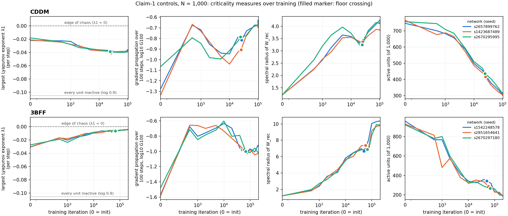

## 2026-11-20 16:55 — Criticality projection, Phase 1: the deterioration is not there, so no remedy was run

Rules, committed before any measurement (61c77f1): `2026-11-20_1643_rules-criticality-projection.md`.
Literature: `2026-11-20_1641_criticality-projection-literature.md`. Branch `wp/criticality-proj`.

**Verdict.** The Phase 1 gate **fails on both tasks**, so by the rules no projection was trained and no
GPU time was used.
- **3BFF: 0 of 3 networks deteriorated.** Training moves the largest Lyapunov exponent λ1 *toward* 0,
  from −0.028 to −0.031 per step at init to −0.006 to −0.007 at the floor crossing and −0.004 to −0.005 at
  200,000 iterations. Over the same span the number of active units falls from 921-959 to 190-193.
- **CDDM: 1 of 3 deteriorated.** λ1 moves *away* from 0 in all three networks, from −0.018 to −0.022 at
  init to −0.038 to −0.041 at the floor crossing. Gradient propagation over 100 steps (G100) does not
  get worse, though. The read-out's sensitivity pulled back 100 steps decays by a factor of 12-22 at
  init and 6-8 at the floor crossing. G100 changes by more than the bar (a factor of e) in one network
  only.

**Per variant.** (a) spectral radius, (b) singular values, (c) incoming row norms and (d) the
Lyapunov-targeted gain: **not run, no verdict.** The rules allow a remedy run only on a task whose gate
passes.

The premise, that training degrades signal propagation through time and that this goes with unit loss,
does not hold for these networks in the form the rules test. On 3BFF the network moves closer to the
edge of chaos while it loses units. On neither task does gradient propagation from the read-out
decrease between init and the floor crossing; at 100 steps it increases on both.

### What was measured

`criticality_read.py` (cd30505) on the claim-1 controls with kept snapshots, N = 1,000. CDDM:
`CDDM_c1_snapshots/EqType=h_N=1000_arm=control`, 3 networks. 3BFF: `NBitFlipFlop_c1_snapshots` continued in
`..._c200000`, 3 networks. Run folders and the snapshots read were copied from Della into
`firstmate/data/criticality-proj/baseline/`. The read took a few minutes on the Mac CPU. Every measure
comes from one noise-free pass over the seeded held-out batch. Output: `data/criticality/phase1_cddm.json`,
`phase1_3bff.json`; gate: `criticality_gate.py`; figure: `fig_criticality_phase1.py` →
`img/internal_figures/criticality_phase1.png`.

### The gate, per network

λ1: median over trials, per step. G100: log10 of the read-out sensitivity pulled back 100 steps
relative to the last step (−1 means a tenfold decay). The gate reads the snapshot at or just after the
floor crossing t*. A network deteriorated if |λ1| grew by more than 0.01 **and** |ΔG100| > 0.434.

| Task | Network (first seed) | t* | λ1 init → t* | Δ\|λ1\| | G100 init → t* | \|ΔG100\| | Deteriorated |
|---|---|---|---|---|---|---|---|
| CDDM | s2657899762 | 26,028 | −0.0221 → −0.0381 | +0.016 | −1.28 → −0.82 | 0.46 | yes |
| CDDM | s1423687489 | 25,020 | −0.0213 → −0.0407 | +0.019 | −1.34 → −0.91 | 0.43 | no (G100 0.007 under the bar) |
| CDDM | s2670295995 | 24,219 | −0.0182 → −0.0387 | +0.020 | −1.07 → −0.79 | 0.28 | no |
| 3BFF | s1542248578 | 50,073 | −0.0309 → −0.0070 | −0.024 | −1.57 → −0.98 | 0.59 | no (λ1 toward 0) |
| 3BFF | s2851654641 | 58,035 | −0.0304 → −0.0061 | −0.024 | −1.58 → −0.98 | 0.60 | no (λ1 toward 0) |
| 3BFF | s2670297180 | 67,191 | −0.0276 → −0.0065 | −0.021 | −1.48 → −1.00 | 0.48 | no (λ1 toward 0) |

**The gate and other read points** (reported beside the gate by the rules; they do not enter it):
- *3BFF* fails at every read point from 20,000 to 200,000 iterations, because λ1 is nearer 0 than at
  init at each of them.
- *CDDM* gives 0 of 3 at 5,000 and 10,000 iterations, 1 of 3 at 20,000 and at t*, and 2 of 3 at 40,000,
  75,000 and 100,000.
- *Every ΔG100 measured on either task is positive* (+0.07 to +0.87): the read-out sensitivity decays
  less over 100 steps than at init.
- *Why the later CDDM reads count 2 of 3.* Condition 2 as written counts a change of G100 in either
  direction, so it was meant to catch both vanishing and exploding gradients; it did not anticipate a
  change toward less decay. Condition 1 measures distance from 0. Measured the same way,
  |G100(t)| − |G100(0)| > 0.434, condition 2 fails in all six networks at every read point.
- The binding verdict uses the rule as written, at t*: it fails on both tasks.

**Shorter and longer lags.** At 10 steps the 3BFF read-out sensitivity decays more after training than
at init. G10 goes from −0.31 at init to −0.73 to −0.76 at the floor crossing: a decay by a factor of 2
at init against 5-6 at the floor crossing.
The decay then nearly stops, so G100 and G200 are better than at init. On CDDM, G10 rises from about
−0.3 to about 0, and G200 stays near −2 throughout.

### What the weights alone would have said

- **ρ(W_rec) grows 2.7- to 8.6-fold.** The spectral radius of W_rec goes from its initial 1.2 to 3.2-3.4 at
  the CDDM floor crossing (3.8-4.2 at 100,000) and to 6.7-7.4 at the 3BFF crossing (9.8-10.4 at
  200,000).
- **σ1(W_rec)** goes from 2.3 to 8.9-9.0 (CDDM) and 19.6-20.3 (3BFF) at the end.
- **By the weight-only picture these networks are deep in the chaotic regime.** A random network is
  chaotic above gain 1 (Sompolinsky et al. 1988).
- **The dynamics stay ordered** (λ1 < 0) because the fraction of units above threshold at a given time
  step falls from 0.49-0.52 at init to 0.07-0.09 at the end on both tasks. Inactive units zero their
  columns of the step Jacobian.
- **The median spectral radius of the step Jacobian** stays at 0.96-0.99 on CDDM and reaches 1.000 on
  3BFF by 40,000 iterations. The 3BFF networks have marginal modes, consistent with the bits held in
  memory.
- **Variant (a) applied to these networks would divide W_rec by 2.7 to 8.6** (ρ at the floor crossing
  or at the end, over 1.2; derived, not tested). With the
  set of active units unchanged, the effective gain of W_rec D falls by the same factor, and λ1 moves
  toward the all-inactive floor log 0.9 = −0.105, away from 0. On 3BFF this is the opposite of the
  intended effect.

### Checks

- **Init rebuild.** The cosine between W_rec at init and at the first snapshot (500 iterations) is
  0.973-0.986 in all six networks, against 0.0005-0.0012 for the network rebuilt with seed + 1. In the
  end-to-end runs of the projections (below) the init rebuilt by `build_rnn` gives row norms equal to
  the trainer's stored ones within 1.4·10⁻⁷.
- **Independent check of the gate inputs.** `firstmate/data/criticality-proj/proof/oracle_phase1.py`,
  output `oracle_phase1_output.txt`.
  - *How it was written*: numpy float64, with the forward pass written from the update equation and
    neither `criticality.py` nor `RNN_torch.forward` used; the tangent vector starts from a different
    draw. It takes only the held-out inputs and the init rebuild from the production code.
  - *Pass condition*, set before running: |Δλ1| < 10⁻³ and |ΔG100| < 0.02 at init and at t* in every
    network.
  - *Result*: worst |Δλ1| = 7.2·10⁻⁴, worst |ΔG100| = 1.2·10⁻⁶; PASS. The oracle's gate verdict is the
    same as the reader's in all six networks.
- **Measures, known answers** (`tests/test_criticality.py`). Scaled-identity W with every unit on or
  off gives the closed-form exponent, gain and radius. `backward_gain` equals the autograd derivative
  through the update.
- **Projections** (`tests/test_criticality.py`).
  - Checked with numpy: (a) ρ = 1.2; (b) the singular values equal the reference and the learned
    singular vectors are kept; (c) the row norms equal the reference, with directions unchanged.
  - End to end through `run_experiment.py` (CDDM, N = 60, 30 iterations, period 10): (a) ρ = 1.200;
    (b) max |s/s0 − 1| = 4.8·10⁻⁷; (c) max |n/n0 − 1| = 1.4·10⁻⁷. In (d) every event applied the clipped
    factor exp(0.05), because λ̂1 was −0.038 per step.
- **Off is unchanged.** The control command at main (ad5072e, via `git archive`) and this branch's
  launcher command with `wrec_projection=none`, seed 12345, N = 50, 30 iterations, on CDDM and 3BFF:
  `LastParams`, `TrainLosses` and the participation trace are identical array by array.
- **Launcher.** The launcher, stubbed (module, conda, srun) at N = 50 for 30 iterations, ran one task
  per arm. Each arm's saved config differs from the control's only in `trainer.wrec_projection` (and in
  the seed and tag).

### Limits

- **Coverage.** Three networks per task at N = 1,000 and one setting of the network (the standard
  network).
- **Trajectories.** λ1 is a finite-time exponent from one tangent vector per trial, measured on
  noise-free trajectories, while training uses noisy ones.
- **G100 seed and window.** G100 is seeded from the read-out at the last step. On CDDM its 100 steps lie
  in the decision period (steps 200-300), so it measures how far output-relevant gradients travel, not
  the slowest direction of the whole trial.
- **CDDM floor crossing.** The CDDM crossing is uncertain by about ±30% (`docs/AGENT_GUIDE.md`). The
  CDDM count is 1 of 3 at both read points inside that band (20,000 and t*).

### What is in the branch for later

The four projections stay in the code, off by default (`Trainer.wrec_projection_`,
`configs/experiment/criticality_proj.yaml`), with the launcher `slurm/criticality_proj_della.slurm`. Running
them needs a new rules entry, because this one says no remedy run follows a failed gate.
- **Recommendation: do not run them on the strength of this idea.** On 3BFF the networks approach
  criticality while losing units, so restoring the initial regime there would move λ1 further from 0.
- **If the CDDM half is still wanted.** λ1 moving away from 0 in all three CDDM networks is the part of
  the premise that does hold. A CDDM-only screen of the four arms with a matched control is 15 runs of
  about 4 GPU-hours, about 60 GPU-hours, submitted with
  `TASK=cddm sbatch --chdir=<pinned clone> --export=ALL --time=08:00:00 --array=1-15 slurm/criticality_proj_della.slurm`.

No claim of the paper changes, so `docs/paper_audit.md` is not edited. The paper repository is not
touched.
