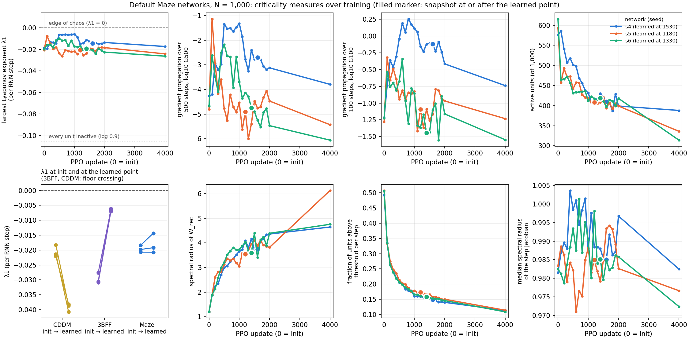

## 2026-11-20 18:14 — Criticality on Maze, Phase 1: the deterioration is not there either, so no projection was run

Rules, committed and pushed before any measurement (d44c5de): `2026-11-20_1733_rules-criticality-maze.md`. Branch
`wp/criticality-maze`. Supervised gate and its result: `2026-11-20_1643_rules-criticality-projection.md`,
`2026-11-20_1655_criticality-projection-phase1-result.md`.

**Verdict.** The Maze gate **fails: 0 of 3 networks deteriorated.** By the rules no projection was trained, and no
GPU training time was used. (One Della GPU job of under 2 minutes replayed probes for a check, below.)
- From init to the learned point, the largest Lyapunov exponent λ1 of the Maze networks hardly moves: from
  −0.018 to −0.021 per step at init to −0.014 to −0.021 at the learned point. One network moves 0.004 toward 0;
  the other two change by less than 0.001. The bar is a move of 0.01 away from 0.
- Gradient propagation over 500 RNN steps (100 decisions, G500) changes by less than a factor of 1.3 in two
  networks. In the third it decays 37-fold less after training than at init (a 18,000-fold decay at init, 500-fold
  at the learned point).
- Over the same span the number of active units falls from 576-616 to 408-419 (of 1,000).

**Per variant.** (a) spectral radius, (b) singular values, (c) incoming row norms and (d) the Lyapunov-targeted
gain: **not run, no verdict.**

**Pavel's question: could Maze, the harder task, need criticality where 3BFF and CDDM do not?** On these networks,
no. Maze networks start and end in the same ordered regime. At the learned point their λ1 lies between the other
two tasks: closer to 0 than every CDDM network, farther than every 3BFF network. 3BFF, the task that holds its
bits in memory for as long as a trial lasts, is the one closest to the edge of chaos (λ1 = 0) at its floor
crossing, consistent with the marginal modes reported in the supervised result.

### What was measured

`criticality_maze.py read` (this branch) on the three G12 default Maze controls at N = 1,000
(`Maze_suite/N=1000_act=relu` seeds 4-6, with their continuations to update 4,000). These are the only default Maze
networks with an init rebuild and kept snapshots near the learned point (rules entry). Read on the Mac CPU from
the local copies of the run and snapshot trees, in about 6 minutes per network. Every measure comes from one probe
pass per weight state: 128 fixed starts, noise-free, the policy mean as the action, over each episode's live steps
only. Output: `data/criticality/phase1_maze.json`. Gate: `criticality_maze.py gate`. Cross-task reading:
`criticality_maze.py cross`. Figure: `fig_criticality_maze.py` → `img/internal_figures/criticality_maze.png`.

### The gate, per network

λ1: median over episodes, per RNN step. G500 and G100: log10 of the read-out sensitivity at an episode's last live
state, pulled back 500 or 100 RNN steps (−1 means a tenfold decay). Read at the kept snapshot at or just after the
learned point. A network deteriorated if |λ1| grew by more than 0.01 **and** |ΔG500| > 0.434.

| Network | Learned at update | Read at | λ1 init → learned | Δ\|λ1\| | G500 init → learned | \|ΔG500\| | G100 init → learned | Active units init → learned | Deteriorated |
|---|---|---|---|---|---|---|---|---|---|
| s4 | 1,530 | 1,600 | −0.0184 → −0.0144 | −0.004 | −4.26 → −2.70 | 1.57 | −1.22 → −0.12 | 576 → 410 | no (λ1 toward 0) |
| s5 | 1,180 | 1,200 | −0.0207 → −0.0207 | +0.000 | −4.80 → −4.90 | 0.10 | −1.28 → −1.09 | 594 → 408 | no |
| s6 | 1,330 | 1,400 | −0.0198 → −0.0192 | −0.001 | −4.67 → −4.74 | 0.07 | −1.23 → −1.44 | 616 → 419 | no |

The learned updates equal those of entry 2026-11-07_0707. The 500-step horizon fits inside the episodes: the
median episode lasts 2,500 RNN steps at init (most episodes never reach the cheese) and 1,005-1,055 RNN steps
(about 200 decisions) at the learned point. At least 112 of the 128 episodes reach 501 live states in every state
the gate reads, so the fallback lags were not used. Every episode enters λ1 (128 of 128).

**Other read points** (reported beside the gate by the rules; they do not enter it):
- *Condition 1 fails at every read point.* Across all 21 later weight states of each network (updates 100-2,000
  and 4,000), the largest move of λ1 away from its init value is 0.0065 per step (s6 at update 4,000). The gate
  gives 0 of 3 at every read point.
- *Measured as a change in decay only*, |G500(L)| − |G500(0)| > 0.434, condition 2 also fails in all three
  networks: s4 decays less than at init (−1.57), s5 and s6 more by 0.10 and 0.07.
- *After the learned point, gradient propagation does decrease.* Between the learned point and update 4,000,
  G500 falls by a factor of 12 (s4), 3.4 (s5) and 21 (s6); λ1 moves away from 0 by 0.003, 0.004 and 0.007 per step,
  below the 0.01 bar; the number of active units falls from 410, 408 and 419 to 388, 336 and 314. This window lies
  outside the gate, which compares init with the learned point.
- *Before the learned point, s4 moves toward 0.* Between updates 500 and 1,100, s4's λ1 sits at −0.006 to −0.009
  and its G500 at −1.3 to −1.9, then returns to about −0.014 and −2.7 by the learned point (figure, blue line).

### Do harder tasks sit closer to criticality? (descriptive, not a gate)

λ1 per RNN step, at init and at the learned point (3BFF and CDDM: the snapshot at or just after the floor crossing,
values from `data/criticality/phase1_*.json`):

| Task | λ1 at init | λ1 at the learned point | Read at |
|---|---|---|---|
| CDDM (3 networks) | −0.018 to −0.022 | −0.038 to −0.041 | iterations 24,500-26,500 |
| 3BFF (3 networks) | −0.028 to −0.031 | −0.006 to −0.007 | iterations 50,500-67,500 |
| Maze (3 networks) | −0.018 to −0.021 | −0.014 to −0.021 | updates 1,200-1,600 |

By the rule set before the measurement: Maze sits **closer to 0 than CDDM** (every Maze network's |λ1| is smaller
than every CDDM network's) and **farther from 0 than 3BFF** (every Maze network's |λ1| is larger than every 3BFF
network's). The suspicion that simpler tasks do not need criticality predicted Maze closest to 0, and that ordering
is not what was measured. Training moves the three tasks in three directions from similar starting points: 3BFF
toward 0, CDDM away from it, Maze hardly at all. On every task λ1 stays negative at the learned point, so every
network trained here sits on the ordered side of the edge of chaos. The reading does not measure task difficulty,
and Maze trajectories are closed-loop with each observation held for 5 steps, unlike the supervised trials.

### What the weights alone would have said

- **ρ(W_rec) triples by the learned point**, from 1.2 at init to 3.6-3.7 (4.7-6.1 at update 4,000); σ1(W_rec) goes
  from 2.3 to 7.7-8.5.
- **The fraction of units above threshold at a given step falls** from 0.49-0.51 at init to 0.15-0.17 at the
  learned point (0.11 at update 4,000), so inactive units zero most columns of the step Jacobian, as on the
  supervised tasks.
- **The median spectral radius of the step Jacobian stays between 0.97 and 1.00** at every read point.
- **Variant (a) applied to these networks would divide W_rec by about 3** at the learned point (ρ 3.6-3.7 over 1.2;
  derived, not tested). With the set of active units unchanged, λ1 would move toward the all-inactive floor
  log 0.9 = −0.105, away from 0.

### Checks

- **Init rebuild.** The cosine between W_rec at init and at the first snapshot (update 100) is 0.955-0.958 in all
  three networks, against 0.0002-0.0018 for the network rebuilt with seed + 1.
- **Independent check of the gate inputs** (`firstmate/data/criticality-maze/proof/oracle_maze.py`, output
  `oracle_maze_output.txt`). The script is numpy float64 code written from the update equation; it does not use
  `criticality.py` or `RNN_torch`'s forward pass, and its tangent vector starts from a different draw. From
  production code it takes only the init rebuild and the probe rollout (observations, episode ends, actions).
  - Its forward pass reproduces the network's actions within 2.3·10⁻⁶ at every live decision.
  - It finds the same learned updates and snapshots in all three networks.
  - Worst |Δλ1| = 1.6·10⁻⁴ (bar 10⁻³), worst |ΔG| = 3.7·10⁻³ over G500 and G100 (bar 0.02); its gate gives 0 of 3.
    **PASS.**
- **Measures with lengths** (`tests/test_criticality.py::test_lengths_option`). With every length equal to T the
  results are identical to the call without lengths. An episode cut to length L gives the unmasked result on its
  first L states, states after L are ignored, and a known-answer case gives log(1 − α + αc). All tests of the file
  and `tests/test_no_function_imports.py` pass.
- **The probe is reproduced: failed as written, investigated to its cause.** The reader's probe, replayed on the
  CPU, differs from the training probe's stored values. Of the 63 comparisons (21 weight states per network),
  38 exceed the bar: 5 by more than 5 active units and 34 by more than 2 of 128 episodes. The largest differences
  are 18 units (s4 at update 1,900: 429 against 411) and 18 episodes (s4 at update 200: 81 against 63
  successes). At the gate's snapshots the
  differences are 3, 1 and 5 units and 5, 3 and 1 episodes.
  - *Cause: the probe depends on the device.* `TrainerPPO.probe` draws its 128 starts from a `torch.Generator` on
    the task's device. During training that device was a GPU, whose generator gives a different random stream from
    the CPU generator for the same seed. The closed-loop arithmetic also differs between the two devices.
  - *Confirmed on GPU.* The trainer's own probe, replayed on a Della A100 (job 18030865, files in
    `firstmate/data/criticality-maze/proof/probe_gpu_replay*`), reproduces the stored values exactly, active units
    and successes, at all 8 snapshots tried, including the three the gate reads and the four with the largest
    differences. The reader therefore reads the right weights through the right probe code.
  - *Per-step rounding on the CPU does not explain the gap.* Computing the RNN step in float64 and rounding to
    float32 changes the CPU probe by at most 2 units and 1 episode (`probe_rounding_test.txt`).
  - *The gate does not depend on the start set.* Across four sets of 128 starts on the CPU (probe seed + 0 to 3),
    λ1 changes by at most 0.0006 per step and G500 by at most 0.26 (`probe_startset_spread.txt`). The gate's
    margin on condition 1 is 0.010-0.014 per step in the three networks, 16 or more times that spread.

### Limits

- **Coverage.** Three networks, N = 1,000, one network configuration (the paper's default Maze network,
  `freeze_after_end` false). No other default Maze network has kept snapshots.
- **Trajectories.** λ1 is a finite-time exponent from one tangent vector per episode, measured on noise-free
  probe trajectories, while training uses noisy ones. The Jacobian treats observations as given, which is the
  map PPO's gradient passes through; the loop through the maze is not part of it.
- **G seed.** G is seeded from the read-out at an episode's last live state, the decision that reached the cheese
  for learned networks and decision 500 at init, where most episodes never end. The two states therefore read G
  from different points of an episode.
- **Probe counts across devices.** Any reader that replays a Maze probe on the CPU plays other starts than the
  training probe played on its GPU. In these networks that moved the number of active units by up to 18 and probe
  success by up to 18 of 128 episodes. Comparisons with stored probe values need a GPU replay, or both sides
  replayed on one device.

### Recommendation

Do not run the projections on Maze. On all three tasks the networks lose units while λ1 stays negative and does
not move away from 0 between init and the learned point by the gate's bar. Restoring the initial spectral regime
would therefore not restore a lost property; on 3BFF and Maze it would move λ1 further from 0. If the idea is
pursued, the window where Maze networks change is after the learned point: there gradient propagation over 500
steps falls 3- to 21-fold while units keep being lost. A new rules entry would be needed for that window, because
this gate compares init with the learned point.

No claim of the paper changes, so `docs/paper_audit.md` is not edited. The paper repository is not touched.
